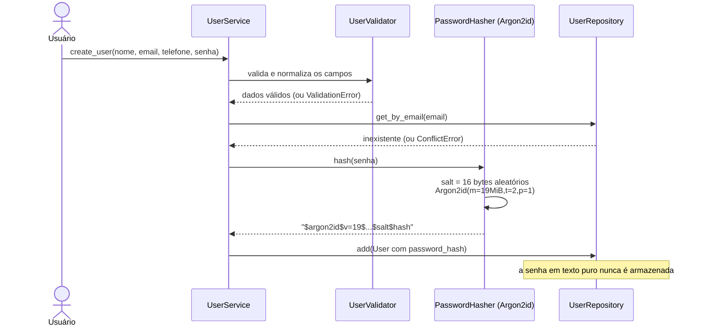
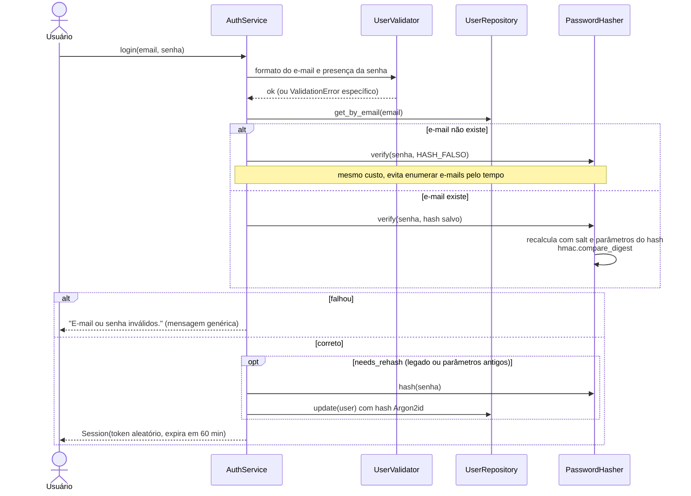

# Entrega 2 — Hash e autenticação segura

**Projeto:** KoraAgenda (backend Python)
**Situação-problema:** a aplicação precisa cadastrar usuários **sem armazenar senhas em texto puro**.

## 1. Requisitos × onde foram atendidos

| Requisito mínimo | Atendimento | Onde |
|---|---|---|
| Cadastro/login com Argon2id, scrypt, bcrypt ou PBKDF2 com configuração apropriada | **Argon2id** com m = 19 MiB, t = 2, p = 1 (mínimo OWASP). PBKDF2-SHA256 com 600.000 iterações fica como algoritmo legado | `app/core/security.py`, `app/core/config.py`, `app/container.py` |
| Armazenar hash e salt | Formato PHC: algoritmo, versão, parâmetros, **salt (16 bytes aleatórios)** e hash no mesmo campo `password_hash` | `Argon2idPasswordHasher.hash` |
| Testar login correto e incorreto | 15 testes da Entrega 2, mais os testes de autenticação que já existiam (87 no total, todos passando) | `tests/test_password_hashing.py`, `tests/test_auth_service.py` |
| Explicar por que SHA-256 isolado não é adequado | Seção 4 deste documento e etapa 4 da demonstração, com números medidos | `demo_entrega2.py` |
| Demonstrar comparação segura pela biblioteca | `hmac.compare_digest` (stdlib), com teste que prova o uso | `verify()` em `security.py`, `test_uses_constant_time_comparison_from_library` |

**Produto:**

| Item | Arquivo |
|---|---|
| Aplicação | `main.py` (menu) e `app/` |
| Testes | `tests/` |
| Evidência do registro protegido | `evidencias/entrega2_registros.json` e `evidencias/entrega2_saida.txt` |
| Evidência dos testes | `evidencias/entrega2_testes.txt` |
| Documentação do fluxo | este arquivo |

## 2. Como executar

```bash
cd backend
pip install -r requirements.txt          # cryptography >= 44 (traz o Argon2id)
python -m unittest discover -v           # todos os testes
python -m unittest tests.test_password_hashing -v   # só a Entrega 2
python demo_entrega2.py --sem-pausa      # demonstração + gera evidencias/
python main.py                           # menu interativo (cadastro/login)
```

## 3. Escolhas técnicas

### 3.1 Por que Argon2id
- Venceu a *Password Hashing Competition* (2015), é padronizado na **RFC 9106** e é a **1ª recomendação da OWASP**.
- É *memory-hard*: cada tentativa ocupa cerca de 19 MiB de RAM, o que torna caros os ataques com GPU e ASIC (que têm muito processamento e pouca memória por núcleo).
- A variante "id" combina resistência a ataques de canal lateral (Argon2i) com resistência a GPU (Argon2d).
- Já vem na biblioteca `cryptography`, que o projeto usava desde a Entrega 1. **Nenhuma dependência nova foi adicionada.**
- O bcrypt foi descartado porque trunca a senha em 72 bytes. O scrypt seria aceitável, mas a OWASP o coloca abaixo do Argon2id.

### 3.2 Parâmetros

| Parâmetro | Valor | Justificativa |
|---|---|---|
| memória `m` | 19.456 KiB (19 MiB) | Mínimo recomendado pela OWASP |
| iterações `t` | 2 | Par recomendado para m = 19 MiB |
| paralelismo `p` | 1 | Idem |
| salt | 16 bytes de `secrets.token_bytes` | CSPRNG; o salt é único por senha |
| tamanho do hash | 32 bytes | 256 bits |
| tempo medido | cerca de 70 ms por login | Imperceptível para o usuário e caro para o atacante |

Os parâmetros ficam em `Settings` e podem ser aumentados sem quebrar nada (veja 3.4).

### 3.3 Formato armazenado (hash + salt)

```
$argon2id$v=19$m=19456,t=2,p=1$+nFxdeyVNtzgpXI2dA6TqA$zpWwHUq3zw6UGWoxjt1LZ3esh9rgQeWHsrtmFZ8j9b0
 └ alg ──┘ └ver┘ └─ custo ─────┘ └── salt (base64) ──┘ └──────── hash (base64) ───────────────┘
```

O registro é **autodescritivo**: a verificação lê os parâmetros do próprio hash. Assim, trocar a configuração no futuro não invalida as senhas já salvas.

### 3.4 Boas práticas para não quebrar a aplicação
A Entrega 2 foi implementada de forma **aditiva**, sem remover componentes:

1. **Mesma interface.** Os serviços continuam dependendo da abstração `PasswordHasher`. Só o `Container` mudou para montar o hasher novo, e `UserService`, `main.py` e repositórios não foram alterados.
2. **Agilidade de algoritmo.** O `UpgradingPasswordHasher` gera hashes novos em Argon2id e continua validando os hashes PBKDF2 antigos.
3. **Migração transparente (rehash on login).** No login correto, se `needs_rehash()` indicar hash legado ou parâmetros desatualizados, o hash é regravado com o algoritmo atual. Ninguém precisa trocar a senha e não há reset em massa. Um login com senha errada **não** migra o hash.
4. **Compatibilidade de configuração.** `PASSWORD_HASH_ITERATIONS` e `Settings.password_hash_iterations` continuam existindo, e `app/crypto` (Entrega 1) não foi tocado.
5. **Regressão comprovada.** Os 72 testes anteriores passaram **sem alteração** depois da mudança.

## 4. Por que SHA-256 isolado não é adequado para senhas

SHA-256 é uma função de hash criptográfica **rápida e determinística**, projetada para integridade (checksums, assinaturas, blockchain). Para senhas essas qualidades viram defeitos:

| Problema | Consequência | Como o Argon2id resolve |
|---|---|---|
| **Sem salt**: mesma senha gera o mesmo hash | Senhas iguais ficam visíveis no banco, e *rainbow tables* revertem o hash na hora | Salt aleatório por senha |
| **Rápido demais**: cerca de 530 mil hashes/s em 1 núcleo, bilhões/s em GPU | Um dicionário de 14 milhões de senhas (rockyou) é testado em cerca de 27 s | Cerca de 15 tentativas/s: o mesmo dicionário leva cerca de 11 dias **por usuário** |
| **Custo fixo** | Não acompanha a evolução do hardware | Custo configurável (m, t, p) e migração automática |
| **Pouca memória** | Paraleliza muito bem em GPU e ASIC | 19 MiB por tentativa limitam o paralelismo |

Os números acima foram **medidos nesta máquina** e estão na etapa 4 de `evidencias/entrega2_saida.txt`. Na mesma etapa, o hash SHA-256 de `senha1234` foi quebrado por dicionário em **0,036 ms**.

> "SHA-256 com salt" resolve só a primeira linha da tabela. Continua rápido demais, por isso a recomendação é usar uma **KDF de senha** (Argon2id, scrypt, bcrypt ou PBKDF2).

## 5. Comparação segura

```python
actual = self._derive(password, salt, memory, iterations, lanes, len(expected))
return hmac.compare_digest(actual, expected)   # tempo constante (stdlib)
```

- `==` entre bytes encerra a comparação no primeiro byte diferente. O tempo de resposta revela quantos bytes iniciais estão corretos, o que viabiliza um *timing attack*.
- `hmac.compare_digest` compara todos os bytes e leva o mesmo tempo para qualquer entrada.
- O teste `test_uses_constant_time_comparison_from_library` instrumenta `hmac.compare_digest` e confirma que ele é chamado em toda verificação, com senha correta ou errada.

## 6. Fluxo documentado

### 6.1 Cadastro



### 6.2 Login



## 7. Testes (positivos e negativos)

`tests/test_password_hashing.py`:

| Teste | Tipo | Verifica |
|---|---|---|
| `test_hash_is_phc_with_owasp_parameters` | + | Formato e parâmetros; senha ausente do hash |
| `test_salt_is_stored_and_random` | + | Mesma senha gera salts e hashes diferentes, e ambos validam |
| `test_correct_and_incorrect_password` | +/− | Correta aceita; variações (maiúscula, espaço, vazia) recusadas |
| `test_unicode_password` | +/− | Acentos e emoji sem normalização indevida |
| `test_tampered_or_malformed_hash_is_rejected` | − | Hash adulterado, algoritmo ou versão trocados, parâmetros inválidos |
| `test_uses_constant_time_comparison_from_library` | + | `hmac.compare_digest` é usado |
| `test_needs_rehash_when_parameters_change` | + | Detecta parâmetros antigos sem invalidar o hash |
| `test_new_hashes_use_argon2id` | + | Hashes novos usam o algoritmo atual |
| `test_legacy_pbkdf2_hash_still_verifies_and_needs_rehash` | +/− | Compatibilidade com o legado |
| `test_unknown_format_is_rejected` | − | SHA-256 puro ou texto puro no banco não autenticam |
| `test_stored_record_has_no_plaintext_password` | + | Nenhum campo do registro contém a senha |
| `test_login_correct` | + | Login gera sessão válida |
| `test_login_incorrect` | − | Senha errada, maiúscula diferente e e-mail inexistente dão a mesma mensagem |
| `test_unknown_email_still_computes_a_hash` | − | E-mail inexistente também calcula hash (anti-enumeração) |
| `test_legacy_hash_is_migrated_on_successful_login` | +/− | Migra só no login correto |

Saída completa em `evidencias/entrega2_testes.txt`.

## 8. Mapeamento de segurança

| Referência | Item | Como é atendido |
|---|---|---|
| OWASP Top 10:2025 **A04** — Cryptographic Failures | Armazenamento de senha | Argon2id com salt; nada de hash rápido nem texto puro |
| OWASP Top 10:2025 **A07** — Authentication Failures | Login | Mensagem genérica, tempo uniforme, sessão com expiração, revogação na troca de senha |
| ASVS 5.0 **V11.4.2** | Senhas armazenadas com KDF de custo adequado | Argon2id com parâmetros OWASP |
| ASVS 5.0 **V6** (Authentication) | Senha mínima de 8, até 128 caracteres, sem truncar | `UserValidator`; Argon2id não trunca (ao contrário do bcrypt) |
| ISO/IEC 27002:2022 **5.17** | Informações de autenticação | Senha nunca armazenada nem exibida; só o hash |
| ISO/IEC 27002:2022 **8.5** | Autenticação segura | Proteção contra enumeração e brute force offline; sessões seguras |
| ISO/IEC 27002:2022 **8.24** | Uso de criptografia | Algoritmo e parâmetros padronizados e documentados |

## 9. Riscos, limitações e próximos passos

| Item | Situação | Recomendação |
|---|---|---|
| Limite de tentativas de login (brute force **online**) | Não implementado | Bloqueio ou atraso progressivo por conta e IP (ASVS V6.3.1) |
| Regra de composição (exigir letras e números) | Mantida para não mudar o comportamento | O ASVS 5.0 (6.2.5) recomenda **não** exigir composição, e sim tamanho mínimo |
| Bloqueio de senhas comuns ou vazadas | Não implementado | Lista das 3.000 senhas mais comuns (ASVS 6.2.4) ou consulta k-anonymity ao *Have I Been Pwned* |
| *Pepper* (segredo fora do banco) | Não implementado | Parâmetro `secret` do Argon2id, com chave vinda de cofre ou variável de ambiente |
| Armazenamento em memória | Os dados somem ao encerrar | Repositório PostgreSQL implementando `UserRepository` |
| DoS por senha longa | Mitigado | Limite de 128 caracteres antes do hash |
| Custo do Argon2id por login (~70 ms, 19 MiB) | Aceito | Combinar com limite de taxa para não virar vetor de DoS |

## 10. Referências

- OWASP Password Storage Cheat Sheet — https://cheatsheetseries.owasp.org/cheatsheets/Password_Storage_Cheat_Sheet.html
- OWASP Authentication Cheat Sheet — https://cheatsheetseries.owasp.org/cheatsheets/Authentication_Cheat_Sheet.html
- OWASP ASVS 5.0 — https://owasp.org/www-project-application-security-verification-standard/
- RFC 9106 — Argon2 Memory-Hard Function — https://www.rfc-editor.org/rfc/rfc9106
- PHC string format — https://github.com/P-H-C/phc-string-format
- `cryptography` Argon2id — https://cryptography.io/en/latest/hazmat/primitives/key-derivation-functions/#argon2id
- Python `hmac.compare_digest` — https://docs.python.org/3/library/hmac.html#hmac.compare_digest
- NIST SP 800-63B — Digital Identity Guidelines (Authentication)
